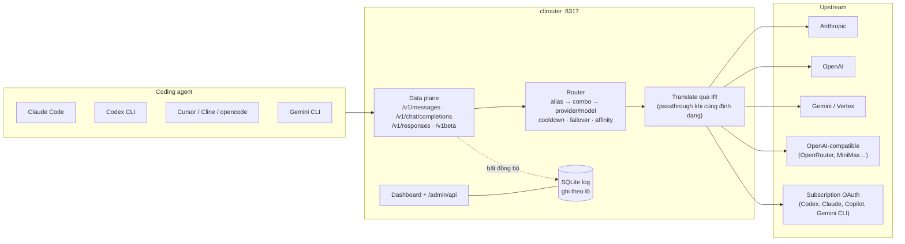

# clirouter

Gateway LLM tốc độ cao cho coding agent (Claude Code, Codex CLI, Cursor, Cline, Gemini CLI…).
Một endpoint duy nhất, định tuyến tới Anthropic, OpenAI, Gemini/Vertex, mọi provider
OpenAI-compatible, và tài khoản subscription qua OAuth. Một binary Go (~13 MB, ~25 MB RAM),
dashboard nhúng sẵn.




## Chạy nhanh

```bash
make build            # build dashboard + binary (cần Node 20+ và Go 1.27+)
./bin/clirouter       # lần đầu tự tạo ~/.clirouter/config.yaml
```

Mở dashboard tại http://127.0.0.1:8317 → **Providers** → thêm provider và key.

## Kết nối client

| Client | Cấu hình |
|---|---|
| Claude Code | `ANTHROPIC_BASE_URL=http://127.0.0.1:8317` · `ANTHROPIC_AUTH_TOKEN=<client key>` |
| Codex CLI | `~/.codex/config.toml`: `[model_providers.clirouter]` `base_url = "http://127.0.0.1:8317/v1"`, `wire_api = "responses"`, `env_key = "CLIROUTER_API_KEY"` |
| Cursor / Cline / opencode | OpenAI base URL `http://127.0.0.1:8317/v1` |
| Gemini CLI | `GOOGLE_GEMINI_BASE_URL=http://127.0.0.1:8317` |

Trang **Kết nối** trong dashboard sinh sẵn snippet theo cấu hình hiện tại.

## Endpoint

`POST /v1/messages` (+`/count_tokens`) · `POST /v1/chat/completions` · `POST /v1/responses` ·
`POST /v1beta/models/{model}:streamGenerateContent|generateContent` · `GET /v1/models` ·
`GET /healthz` · `GET /metrics` (Prometheus, cần client key như `/v1/models`) · `/admin/api/*` (dashboard).

## Chọn model

Theo thứ tự: **alias** → **combo** → `provider/model` → provider khai báo model đó trong
`models`/`model_map` → provider không khai báo model nào nhưng cùng họ (`claude*`, `gpt*/o*`, `gemini*`).

```yaml
providers:
  - id: anthropic
    type: anthropic
    keys: [env:ANTHROPIC_API_KEY, env:ANTHROPIC_API_KEY_2]   # nhiều key = xoay vòng
  - id: openrouter
    type: openai-compatible
    base_url: https://openrouter.ai/api/v1
    keys: [env:OPENROUTER_API_KEY]
    models: [z-ai/glm-4.6]
    priority: 1                    # số nhỏ được thử trước
combos:
  - name: coding
    strategy: fallback             # hoặc round-robin
    targets: [anthropic/claude-sonnet-4-5, openrouter/z-ai/glm-4.6]
aliases:
  claude-sonnet-4-5-20250929: coding   # Claude Code gọi model này → đi qua combo
```

Loại provider: `anthropic`, `openai`, `openai-compatible`, `gemini`, `vertex`, `codex`,
`claude-oauth`, `copilot`, `gemini-cli`. Key dạng `env:NAME` đọc từ biến môi trường.
Config được theo dõi và nạp lại nóng (2 s), không cần restart (trừ `listen`).

## Dashboard

Ảnh chụp với cấu hình demo (provider giả lập chạy local, key giả).

| | |
|---|---|
|  |  |
| **Providers** — loại, endpoint, số key, model, ưu tiên; bật/tắt nóng. | **Tài khoản** — trạng thái từng key: cooldown theo model, OK/lỗi, lỗi gần nhất. |
|  |  |
| **Combo & Alias** — gom nhiều target thành một tên model (fallback / round-robin). | **Requests** — log từng request: model, provider, TTFB, token, số lần thử. |
|  |  |
| **Kết nối** — snippet cấu hình sẵn cho Claude Code, Codex CLI, Cursor, Gemini CLI, curl. | Giao diện tối, song ngữ Việt / Anh (phím `t`, `l`). |

## Thiết kế cho ổn định và tốc độ

- **Data plane tách khỏi dashboard.** Request suy luận không đi qua framework/middleware nào.
- **Passthrough byte-nguyên-vẹn** khi client và provider cùng định dạng: không parse JSON từng
  chunk, chỉ đọc usage ở event có chứa nó. Khác định dạng thì dịch qua IR có kiểu, encode thẳng
  sang định dạng client (0 alloc mỗi text chunk).
- **Không I/O đồng bộ trên hot path.** Trạng thái định tuyến nằm trong RAM, khoá theo từng
  account. Log request đi qua kênh có giới hạn tới một writer SQLite ghi theo lô; kênh đầy thì
  bỏ và đếm, không bao giờ chặn request.
- **Timeout tách bạch:** `connect` · `first_byte` (tới byte dữ liệu đầu tiên) · `idle` (im lặng
  giữa các chunk, re-arm mỗi lần nhận byte) · `total`. Client ngắt kết nối thì hủy upstream ngay.
- **Keepalive:** sau `early_ping` gửi header 200 + ping đúng chuẩn từng định dạng
  (`event: ping` cho Anthropic, comment SSE cho OpenAI), lặp lại mỗi `keepalive` khi im lặng.
- **Failover trước nội dung đầu tiên:** lỗi HTTP, timeout, hoặc lỗi in-band ngay đầu stream
  (ví dụ `overloaded_error` sau 200) đều chuyển account/provider khác mà client không thấy.
  Sau khi đã gửi nội dung, lỗi được báo in-band đúng định dạng client.
- **Cooldown thông minh:** 429 tôn trọng `Retry-After`/header quota, khoá theo model; hết quota
  khoá cả account; 400 không khoá; một lỗi 5xx lẻ không loại account. Cooldown ngắn (≤5 s) thì
  chờ thay vì trả 429.
- **Session affinity:** các lượt cùng hội thoại dính một account để giữ prompt cache.
- **Pool kết nối HTTP/2** dùng chung theo proxy, tắt gzip upstream (gzip làm SSE bị dồn cục).
- **Credential OAuth mã hoá AES-256-GCM**, ghi file nguyên tử, refresh single-flight + chạy nền.

## Bảo mật

clirouter giữ API key/token OAuth của mọi provider, nên mặc định khoá chặt:

- **Bind `127.0.0.1:8317`.** Khi chưa có `api_keys`, API suy luận chỉ nhận request trực tiếp từ
  máy này. Khi chưa có `admin_password`, dashboard/admin API cũng chỉ mở cho localhost — và chỉ
  khi Host là `localhost`/`127.0.0.1`/`[::1]` (chặn DNS rebinding), không có header reverse proxy
  (`X-Forwarded-For`, `Forwarded`, `X-Real-IP`).
- **Mở ra mạng (`listen: 0.0.0.0:8317` hoặc `--listen`)**: nếu chưa đặt `admin_password`, lần
  khởi động đầu clirouter tự sinh mật khẩu ngẫu nhiên và ghi vào `config.yaml` (không in ra log) —
  đọc nó trong file config rồi nhập ở dashboard. Muốn tự đặt: `admin_password: env:CLIROUTER_ADMIN_PASSWORD`.
  Hãy thêm `api_keys` để máy khác dùng được API suy luận. Không gỡ được mật khẩu qua dashboard khi đang expose.
- **Admin API** nhận `Authorization: Bearer <admin_password>`, so sánh constant-time, khoá IP 5 phút
  sau 10 lần sai; từ chối mọi request trình duyệt khác origin (`Origin`/`Sec-Fetch-Site`), không bật CORS.
  Dashboard trả CSP, `X-Frame-Options: DENY`, `nosniff`.
- **Client key** so sánh constant-time, khoá IP 1 phút sau 30 lần sai. Key tạo/lưu qua dashboard
  được lưu dạng băm `sha256:<hex>` (chỉ hiện một lần lúc tạo — hãy copy ngay); có thể tự ghi
  `key: sha256:$(printf %s "$KEY" | shasum -a 256 | cut -d' ' -f1)` vào config.
- **Quyền file**: `~/.clirouter` 0700, `config.yaml` 0600, `data/` 0700, `clirouter.db` 0600, token
  OAuth trong `data/auth/` mã hoá AES-256-GCM (khoá ở `data/auth/.key`, 0600). Khi khởi động, file
  có quyền lỏng hơn sẽ được siết lại. Key provider trong `config.yaml` là plaintext — dùng `env:NAME`
  nếu không muốn ghi key ra đĩa.
- **Không log secret**: log chỉ ghi tên client key; thông báo lỗi upstream (kể cả bản lưu SQLite và
  `last_error` của tài khoản) được che các chuỗi giống key/token. Admin API chỉ trả 4 ký tự cuối của key.
- **Upstream** không follow redirect (Authorization không bị mang sang host khác).
- **Giới hạn đầu vào**: body tối đa `routing.max_body_mb` (kể cả sau giải nén gzip/zstd), header 1 MB
  và 10 s, body phải gửi xong trong 2 phút, mỗi lần ghi cho client tối đa 2 phút.

**Đưa ra Internet**: đặt sau reverse proxy có TLS (Caddy/nginx), luôn đặt `admin_password` và
`api_keys`, để clirouter bind `127.0.0.1` và chỉ proxy cổng đó. Ví dụ Caddy:

```
llm.example.com {
    reverse_proxy 127.0.0.1:8317 {
        flush_interval -1   # không buffer SSE
    }
}
```

Báo lỗ hổng: xem [SECURITY.md](SECURITY.md).

## Không làm (có chủ đích)

MITM / sửa `/etc/hosts` / cài root CA · giả mạo header, TLS fingerprint hay system prompt của
client chính chủ · provider scrape web · gửi request sang LLM bên thứ ba để định tuyến ·
cộng khống token usage.

## Giới hạn đã biết

- **Tài khoản subscription (OAuth)**: luồng đăng nhập Codex/Claude/Copilot/Gemini CLI đã có
  nhưng **chưa kiểm chứng với server thật**. Vì không giả danh client chính chủ, provider có thể
  từ chối (Anthropic có thể chỉ chấp nhận token subscription từ Claude Code; backend Codex có thể
  yêu cầu `instructions` chính thức; Copilot có thể từ chối `Editor-Version` khác VS Code).
  Dùng subscription qua proxy có thể vi phạm điều khoản của provider — tự cân nhắc.
- Chưa hỗ trợ Cursor, Kiro, Codex WebSocket, Vertex service account.

## Phát triển

```bash
make test     # go vet + go test -race ./...
make bench    # benchmark translator, SSE, overhead proxy
cd web && npm run dev   # dashboard dev server, proxy tới :8317
```

Cấu trúc: `internal/proxy` (data plane) · `internal/router` (định tuyến, cooldown, affinity) ·
`internal/translate/*` (codec từng định dạng) · `internal/ir` · `internal/sse` ·
`internal/upstream` (HTTP client, phân loại lỗi) · `internal/auth` (OAuth) ·
`internal/store` (SQLite) · `internal/server` (route, admin API) · `web/` (dashboard React).

## License

[GPL-3.0](LICENSE) © clirouter contributors.
