# clirouter

**A fast, single-binary LLM gateway for coding agents.**
Point Claude Code, Codex CLI, Cursor, Cline, opencode or Gemini CLI at one local endpoint, and
clirouter routes each request to Anthropic, OpenAI, Gemini/Vertex, any OpenAI-compatible API
(OpenRouter, MiniMax, DeepSeek…) or a subscription account via OAuth, translating between API
formats on the fly. It ships as one Go binary (~13 MB, ~25 MB RAM) with an embedded dashboard.

[](https://github.com/Project-by-Myself/clirouter/actions/workflows/ci.yml)
[](LICENSE)

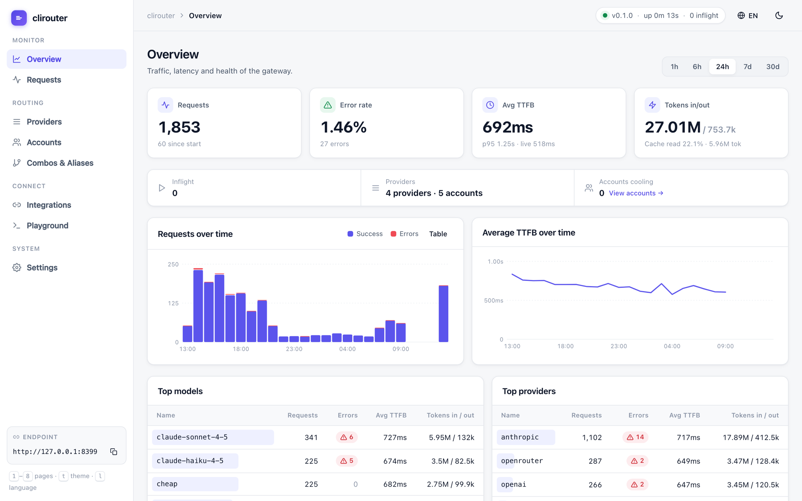

## Features

- **One endpoint, every protocol.** Anthropic Messages, OpenAI Chat Completions, OpenAI
  Responses and Gemini `generateContent`. Any client format can reach any provider.
- **Byte-exact passthrough** when the client and provider speak the same format. Otherwise
  requests are translated through a typed intermediate representation, including streaming, tool
  calls and usage.
- **Failover that clients never see.** HTTP errors, timeouts and in-band errors at the start of a
  stream (e.g. `overloaded_error` after a 200) move to the next account or provider before any
  content reaches the client.
- **Smart cooldowns.** Honors `Retry-After` and quota headers on 429s, cools down per model, and
  treats quota exhaustion differently from a single 5xx, so one transient error never benches an
  account.
- **Multi-key rotation.** Round-robin, fill-first or least-busy across keys, plus session
  affinity so prompt caches keep hitting.
- **Keys for your users, with limits.** Give each person or machine its own client key with
  allowed models, a USD or token budget (daily, weekly, monthly or total), requests per minute,
  max concurrent requests and an expiry date. Disable or rotate a key without affecting anyone
  else. The dashboard writes a ready-to-send message with the endpoint, key and setup steps.
- **Usage and cost tracking.** Every request is priced from a built-in list-price table, which
  you can override per model or zero per provider for flat-rate plans. Totals roll up per key,
  model and provider. Daily usage is kept independently of the request-log retention.
- **Upstream quota tracker.** clirouter reads rate-limit and subscription-window headers
  (Anthropic, OpenAI, Codex 5h/weekly, Claude 5h/7d) and shows the remaining quota and reset
  time per account. Per-provider spend caps make the router skip a provider once its budget is
  used and fall back to the next target.
- **Self-service usage.** Key holders can check their own limits and spend at `/me` or via
  `GET /v1/key/info`.
- **Combos and aliases.** Build one model name out of several targets (`fallback` or
  `round-robin`), and remap the model names your tools hard-code.
- **Dashboard.** Live request tail, latency and token charts, per-account health,
  provider/combo editors, a playground, and copy-paste setup for every supported tool on macOS,
  Linux and Windows. Light/dark theme, English/Vietnamese.
- **Hot reload.** Edit `config.yaml` or use the dashboard; changes apply within ~2 s without a
  restart.
- **Secure by default.** Binds to localhost. Client keys are stored hashed, OAuth tokens are
  encrypted at rest, and secrets are redacted from logs. See [Security](#security).

## How it works

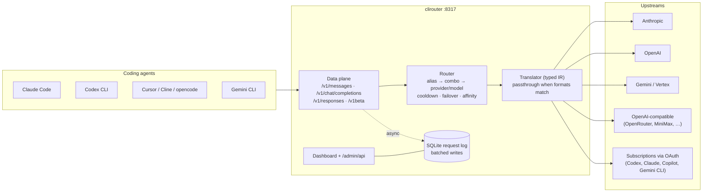

A request flows like this:

1. **Authenticate** the client key (`Authorization: Bearer`, `x-api-key` or `x-goog-api-key`).
2. **Resolve the model** in this order: alias → combo → `provider/model` → a provider that lists
   the model in `models`/`model_map` → a provider with no model list in the same family
   (`claude*`, `gpt*`/`o*`, `gemini*`).
3. **Pick an account** that isn't cooling down, using the routing strategy and session affinity.
4. **Send upstream.** Use passthrough when the formats match, otherwise translate. Stream back
   with per-format keepalive pings.
5. **On failure before the first content byte**, record a cooldown and retry the next
   account/target, up to `routing.max_attempts`.
6. **Log** the result asynchronously: tokens, TTFB, attempts and redacted errors.

## Quick start

Requirements: Go 1.27+, and Node 20+ to build the dashboard.

```bash
git clone https://github.com/Project-by-Myself/clirouter.git
cd clirouter
make build          # builds the dashboard, then bin/clirouter
./bin/clirouter     # first run creates ~/.clirouter/config.yaml
```

Then:

1. Open **http://127.0.0.1:8317**.
2. **Providers → Add provider**: pick a type, then paste one or more API keys.
3. **Settings → Client API keys → Generate key**, if anything other than this machine will
   connect.
4. **Playground**: send a test message.
5. **Integrations**: copy the config for your tool. The Overview page walks you through these
   steps.

Flags: `--config <path>` (default `~/.clirouter/config.yaml`) and `--listen <host:port>`.
Cross-compile release binaries for macOS, Linux and Windows with `make release`.

## Connect your tools

The **Integrations** page generates these snippets with your real address, model and key, for
macOS/Linux shells and Windows PowerShell. It also has a **Test connection** button.

| Tool | Protocol | Setup |
|---|---|---|
| **Claude Code** | `/v1/messages` | `ANTHROPIC_BASE_URL=http://127.0.0.1:8317`, `ANTHROPIC_AUTH_TOKEN=<client key>`, `ANTHROPIC_MODEL=<model>`, plus `ANTHROPIC_DEFAULT_{OPUS,SONNET,HAIKU}_MODEL` |
| **Codex CLI** | `/v1/responses` | `~/.codex/config.toml` → `[model_providers.clirouter]` with `base_url = "http://127.0.0.1:8317/v1"`, `wire_api = "responses"`, `env_key = "CLIROUTER_API_KEY"` |
| **Cursor / Cline / Continue / opencode** | `/v1/chat/completions` | OpenAI-compatible base URL `http://127.0.0.1:8317/v1` + client key |
| **Gemini CLI** | `/v1beta` | `GOOGLE_GEMINI_BASE_URL=http://127.0.0.1:8317`, `GEMINI_API_KEY=<client key>` |
| **Any OpenAI / Anthropic SDK** | all | Set the SDK's base URL to clirouter and use a client key as the API key |

Claude Code example (macOS/Linux):

```bash
export ANTHROPIC_BASE_URL=http://127.0.0.1:8317
export ANTHROPIC_AUTH_TOKEN=sk-clr-...            # a client key from Settings
export ANTHROPIC_MODEL=coding                     # a model, alias or combo
export ANTHROPIC_DEFAULT_OPUS_MODEL=coding
export ANTHROPIC_DEFAULT_SONNET_MODEL=coding
export ANTHROPIC_DEFAULT_HAIKU_MODEL=claude-haiku-4-5
claude
```

Windows PowerShell:

```powershell
$env:ANTHROPIC_BASE_URL = "http://127.0.0.1:8317"
$env:ANTHROPIC_AUTH_TOKEN = "sk-clr-..."
$env:ANTHROPIC_MODEL = "coding"
claude
```

> Setting all three `ANTHROPIC_DEFAULT_*_MODEL` variables makes `/model`, subagents and
> background tasks go through clirouter too, not just the main model.

## Give someone access

1. Make clirouter reachable from their machine. Bind to a LAN, VPN or Tailscale address
   (`listen: 0.0.0.0:8317`, which forces an admin password), or put it behind a TLS reverse
   proxy. Then set **Settings → Public URL** to the address they will use.
2. Open **Keys & usage → Create key**. Pick a name, the allowed models, a budget and period,
   an RPM or concurrency limit, and an expiry date.
3. The key is shown **once**, together with a ready-to-send message: the endpoint, the key,
   their limits, Claude Code setup for macOS/Linux and Windows, and a link to the `/me` usage
   page. Copy it and send it.
4. Watch their usage and estimated cost on the same page. **Disable**, **Rotate** or **Delete**
   the key at any time; changes apply to the next request.

Their own view: `http://<public-url>/me`, or

```bash
curl -H "Authorization: Bearer $KEY" http://<public-url>/v1/key/info
```

## Configuration

Everything lives in `~/.clirouter/config.yaml`. The dashboard edits the same file. Values written
`env:NAME` are read from environment variables.

```yaml
listen: 127.0.0.1:8317

public_url: http://100.64.0.10:8317   # optional: how other machines reach you (used in share messages)

api_keys:                       # client keys; empty = only this machine may call the API
  - name: laptop
    key: sha256:9f86d0…          # stored hashed when created from the dashboard
  - name: alice
    key: sha256:4be1c2…
    note: "Alice – contractor"
    models: [coding, "claude-sonnet-*"]   # allowed model names ("*" suffix = prefix); empty = all
    budget_usd: 20                        # estimated spend cap per period
    budget_tokens: 0                      # input+output token cap per period (0 = none)
    budget_period: monthly                # daily | weekly | monthly | total
    rpm: 60                               # requests per minute
    max_parallel: 4                       # concurrent requests
    expires_at: 2026-12-31T23:59:59+07:00
    disabled: false

providers:
  - id: anthropic
    type: anthropic
    keys: [env:ANTHROPIC_API_KEY, env:ANTHROPIC_API_KEY_2]   # several keys = rotation
  - id: openrouter
    type: openai-compatible
    base_url: https://openrouter.ai/api/v1
    keys: [env:OPENROUTER_API_KEY]
    models: [z-ai/glm-4.6]
    model_map: { glm: z-ai/glm-4.6 }   # client name → upstream name
    priority: 1                         # lower is tried first
    budget_usd: 10                      # skip this provider once $10 is spent…
    budget_period: monthly              # …this month (falls back to the next target)

combos:
  - name: coding
    strategy: fallback                  # or round-robin
    targets: [anthropic/claude-sonnet-4-5, openrouter/z-ai/glm-4.6]

aliases:
  claude-sonnet-4-5-20250929: coding    # a model your tool hard-codes → the combo

timeouts:            # 0 = use the default shown here
  connect: 10s       # TCP + TLS to upstream
  first_byte: 90s    # request sent → first byte of a stream (non-streaming calls wait ≥ 10m)
  idle: 180s         # max silence between chunks (re-armed on every byte)
  total: 60m         # hard cap per request
  early_ping: 2s     # commit 200 + send a ping if upstream is slow to start (0 = off)
  keepalive: 15s     # ping interval while the client sees no bytes (0 = off)

routing:
  strategy: round-robin     # round-robin | fill-first | least-busy
  max_attempts: 6
  session_affinity: true
  max_body_mb: 64

logging:
  level: info
  retention_days: 14
  capture_bodies: false     # store bodies of failed requests for debugging

pricing:                    # USD per 1M tokens; overrides the built-in list prices
  claude-sonnet-4-5: { input: 3, output: 15, cache_read: 0.3, cache_write: 3.75 }
  openrouter/z-ai/glm-4.6: { input: 0.6, output: 2.2 }
  minimax/*: { input: 0, output: 0 }     # flat-rate plan: count tokens, no cost
```

**Client key limits.** When a key breaks a rule, the request never reaches a provider, and the
client receives an error in its own API format:

| Situation | Status | Error type |
|---|---|---|
| Key disabled or expired | 401 | `authentication_error` |
| Model not in the key's `models` | 403 | `permission_error` |
| Budget for the period reached | 402 | `billing_error` |
| `rpm` or `max_parallel` exceeded | 429 + `Retry-After` | `rate_limit_error` |
| Every provider for the model over its budget | 402 | `billing_error` |

Budgets use **estimated** cost. Prices come from the built-in table, can be overridden under
`pricing:`, and are listed under **Settings → Pricing**. Unknown models count tokens but cost $0.
Periods follow the server's local calendar, with weeks starting on Monday. Usage is tracked by
key **name**, so renaming a key starts its counters from zero.

**Provider types**

| Type | Default base URL | Auth |
|---|---|---|
| `anthropic` | `https://api.anthropic.com` | API key |
| `openai` | `https://api.openai.com/v1` | API key |
| `openai-compatible` | *(required)* | API key |
| `gemini` | `https://generativelanguage.googleapis.com` | API key |
| `vertex` | `https://aiplatform.googleapis.com` | API key (express mode, Gemini only) or service account (`sa:`) |
| `azure-openai` | *(required)* `https://<resource>.openai.azure.com` | API key, sent as `api-key` |
| `bedrock` | *(required)* `https://bedrock-runtime.<region>.amazonaws.com` | Bedrock API key, or IAM credentials (`aws:`, SigV4) |
| `ollama` | `http://127.0.0.1:11434/v1` | None (a key is optional) |
| `codex` | `https://chatgpt.com/backend-api/codex` | OAuth (ChatGPT) |
| `claude-oauth` | `https://api.anthropic.com` | OAuth (Claude) |
| `copilot` | `https://api.githubcopilot.com` | OAuth (GitHub device flow) |
| `gemini-cli` | `https://cloudcode-pa.googleapis.com` | OAuth (Google) |

Each provider can also set `headers`, an outbound `proxy`, `disabled: true`, and per-provider
`first_byte` / `idle` timeouts. Config changes hot-reload within ~2 s. Only `listen` needs a
restart. A one-off `--listen` flag applies to that run only and is never written back to the
file. If a hand-edited file is invalid, the last good config keeps running and the error is
logged.

**Cloud and local providers**

```yaml
providers:
  # Azure OpenAI (v1 API: /openai/v1/chat/completions and /responses). The model sent
  # is the deployment name; map client model names to deployments.
  - id: azure
    type: azure-openai
    base_url: https://my-resource.openai.azure.com   # or https://<name>.cognitiveservices.azure.com
    keys: [env:AZURE_OPENAI_API_KEY]
    model_map: { gpt-5: my-gpt5-deployment }

  # Ollama on this machine: no key needed, OpenAI chat format.
  - id: local
    type: ollama                       # base_url defaults to http://127.0.0.1:11434/v1
    models: [qwen3-coder, llama3.3]

  # Claude on Amazon Bedrock. The region comes from the host (or set `region:`).
  - id: bedrock
    type: bedrock
    base_url: https://bedrock-runtime.us-east-1.amazonaws.com
    keys:
      - env:AWS_BEARER_TOKEN_BEDROCK                  # Bedrock API key (Bearer)
      - aws:env                                       # IAM: AWS_ACCESS_KEY_ID / AWS_SECRET_ACCESS_KEY / AWS_SESSION_TOKEN
      - env:BEDROCK_IAM                               # IAM inline: aws:<ACCESS_KEY_ID>:<SECRET>[:<SESSION_TOKEN>]
    model_map: { claude-sonnet-4-5: us.anthropic.claude-sonnet-4-5-20250929-v1:0 }

  # Vertex AI with a service account: Gemini and Claude models.
  - id: vertex
    type: vertex
    region: us-east5                   # location; default: from a <location>-aiplatform host, else global
    project: my-gcp-project            # optional; default: project_id in the key file
    keys: [sa:~/.config/gcloud/clirouter-sa.json]     # or sa:env:GOOGLE_SA_JSON (the JSON itself)
    models: [gemini-2.5-pro]
    model_map: { claude-sonnet-4-5: claude-sonnet-4-5@20250929 }
```

Bedrock and Vertex Claude models are reached through the Anthropic format, so Anthropic clients
get passthrough and other clients are translated. IAM credentials are signed with SigV4 and
service-account tokens (OAuth2 JWT bearer, `cloud-platform` scope) are cached until a minute
before expiry. Once the project is known (from the service account or `project:`), Vertex URLs
use `/v1/projects/<project>/locations/<region>/…`, and a regional `region` turns the default host
into `https://<region>-aiplatform.googleapis.com`. Anthropic `anthropic-beta` headers are
not forwarded to Bedrock.

## API reference

### Inference (client key required when `api_keys` is set)

| Method | Path | Format |
|---|---|---|
| `POST` | `/v1/messages` | Anthropic Messages (streaming and non-streaming) |
| `POST` | `/v1/messages/count_tokens` | Anthropic token counting |
| `POST` | `/v1/chat/completions` (also `/chat/completions`) | OpenAI Chat Completions |
| `POST` | `/v1/responses` (also `/responses`) | OpenAI Responses |
| `POST` | `/v1beta/models/{model}:generateContent` · `:streamGenerateContent` | Gemini |
| `GET` | `/v1/models`, `/v1beta/models` | Models, combos and aliases you can call |
| `GET` | `/v1/key/info` | The calling key's limits and current usage (self-service) |
| `GET` | `/healthz` | Liveness, no auth |
| `GET` | `/metrics` | Prometheus metrics (client key) |

### Admin (dashboard; `Authorization: Bearer <admin_password>` when one is set)

| Method | Path | Purpose |
|---|---|---|
| `GET` | `/admin/api/status` | Version, uptime, listen address, live metrics, account counts |
| `GET` · `PUT` | `/admin/api/config` | Read (secrets masked) / replace the whole config; validated, written atomically, hot-reloaded |
| `GET` | `/admin/api/accounts` | Per key/account health, cooldowns, last error, upstream quota windows |
| `POST` | `/admin/api/accounts/{id}/reset` | Clear an account's cooldown and error state |
| `GET` | `/admin/api/requests?limit&before&provider&model&errors` | Request history (paged) |
| `GET` | `/admin/api/live?n=100` | Most recent requests, including in-flight |
| `GET` | `/admin/api/stats?range=1h\|6h\|24h\|7d\|30d` | Totals, timeline, and breakdowns by model/provider/key |
| `GET` | `/admin/api/models` | Routable model ids with their owner |
| `GET` | `/admin/api/keys/usage` | Per client key: status, current-period and today's usage, in-flight, RPM |
| `GET` | `/admin/api/providers/usage` | Per provider: current-period spend, over-budget flag |
| `GET` | `/admin/api/usage?range=7d\|30d\|90d&group=key\|model\|provider[&key=]` | Usage and estimated cost from the daily rollup, with a per-day series |
| `GET` | `/admin/api/pricing` | Built-in list prices and configured overrides |
| `POST` | `/admin/api/oauth/start` · `/complete` | Start/finish an OAuth login (redirect, paste-code or device flow) |
| `GET` | `/admin/api/oauth/status?flow_id=` | Poll a login flow |
| `GET` · `DELETE` | `/admin/api/oauth/accounts[/{id}]` | List / remove stored OAuth accounts |

## Dashboard

Screenshots use a demo config: a local mock provider and fake keys.

| | |
|---|---|
| 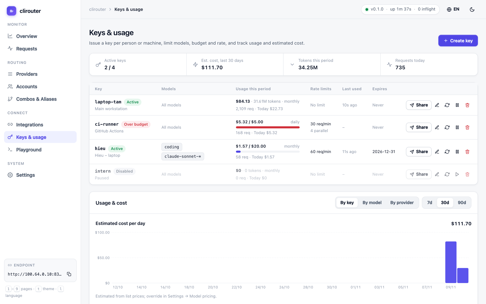 | 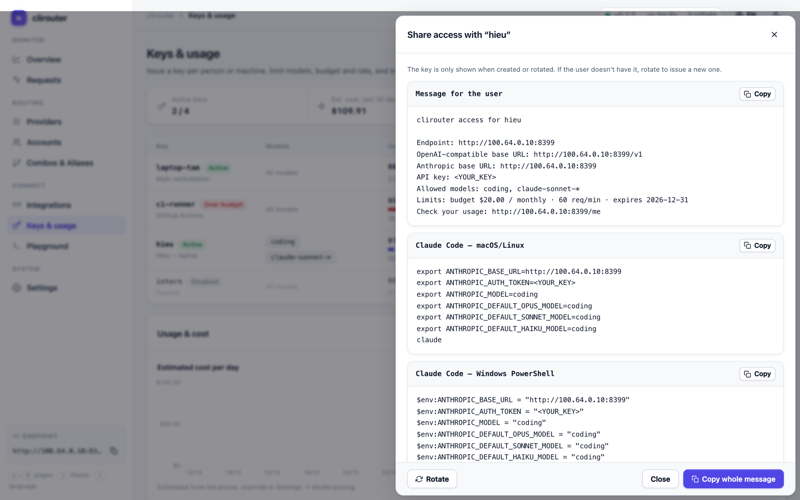 |
| **Keys & usage**: client keys with allowed models, budgets, rate limits and expiry; spend per key/model/provider and daily cost. | **Share**: a ready-to-send message with endpoint, key, limits and Claude Code setup for macOS/Linux and Windows. |
| 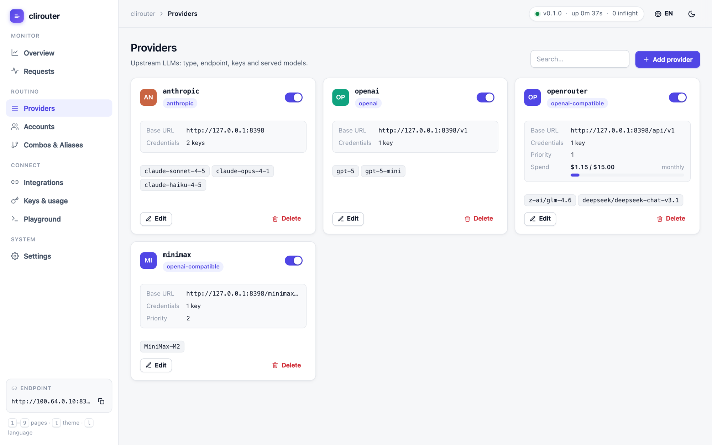 | 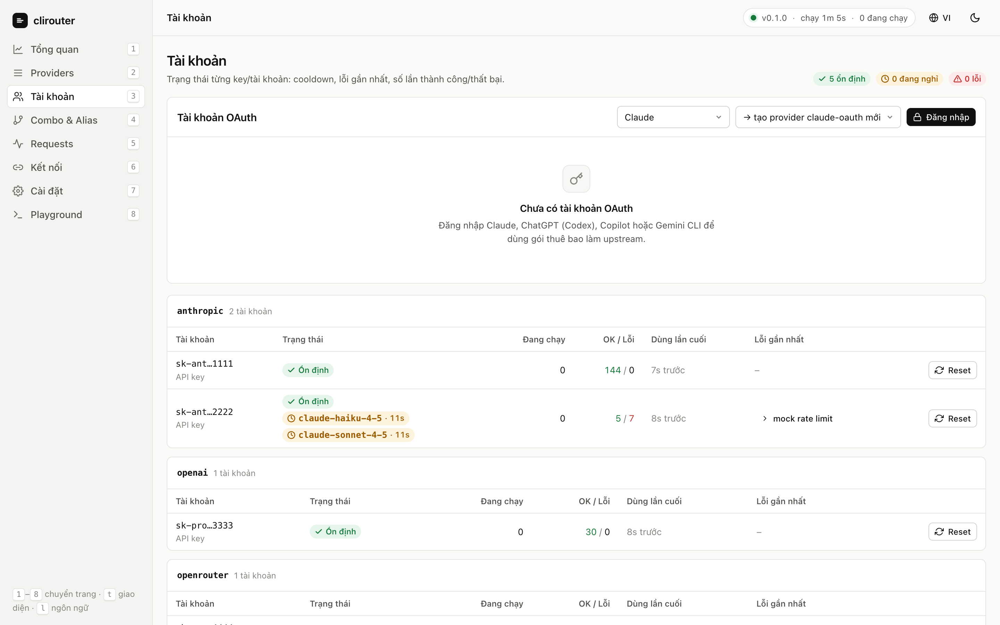 |
| **Providers**: type, endpoint, key count, models, priority, spend vs. budget; toggle live. | **Accounts**: per-key health, upstream quota windows with reset times, cooldowns, last error. |
| 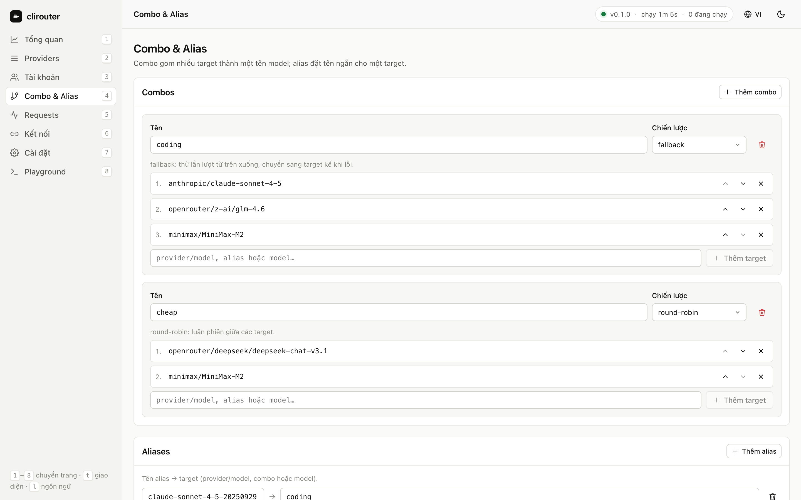 | 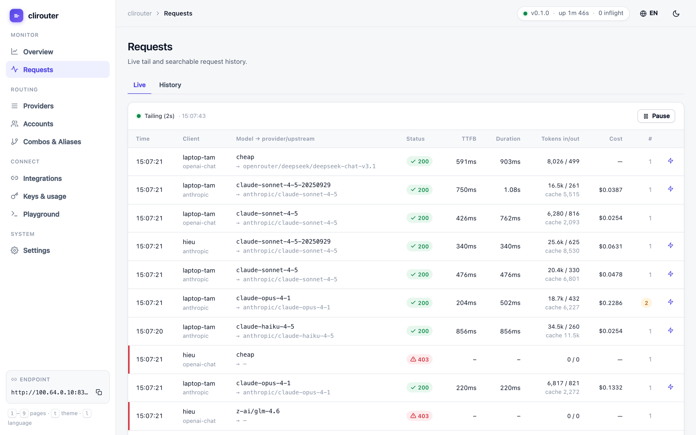 |
| **Combos & aliases**: one model name over several targets (fallback / round-robin). | **Requests**: live tail and history with model → provider/upstream, TTFB, tokens, attempts. |
| 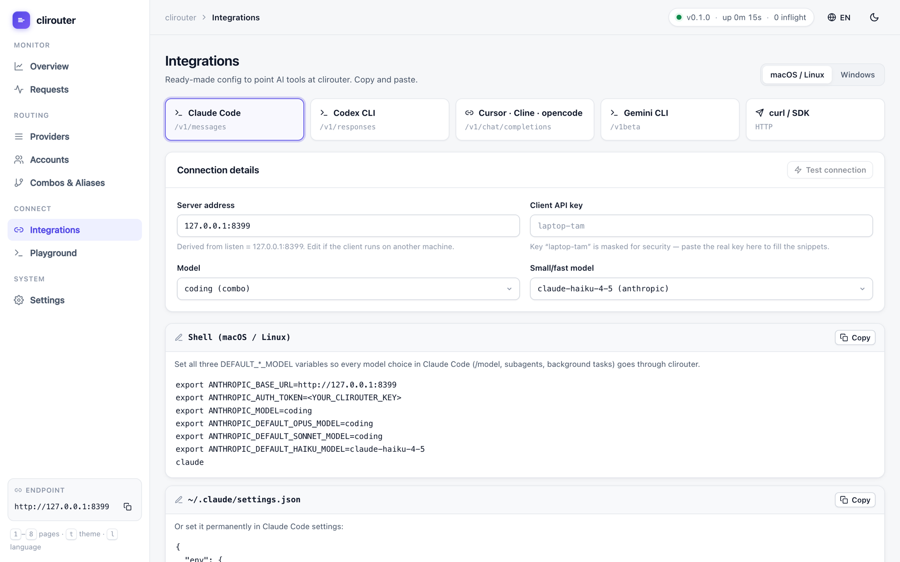 | 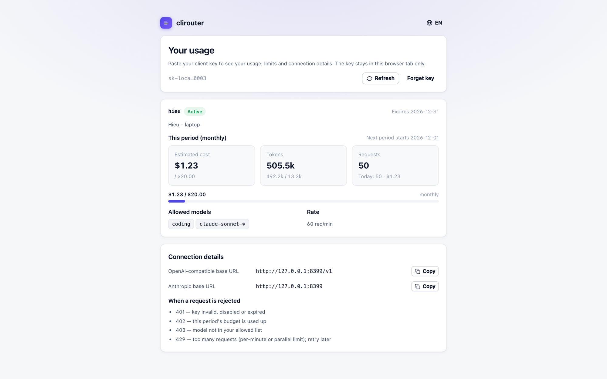 |
| **Integrations**: copy-paste setup for each tool on macOS/Linux and Windows, with a connection test. | **`/me`**: key holders check their own usage, limits and endpoints, with no admin access needed. |
| 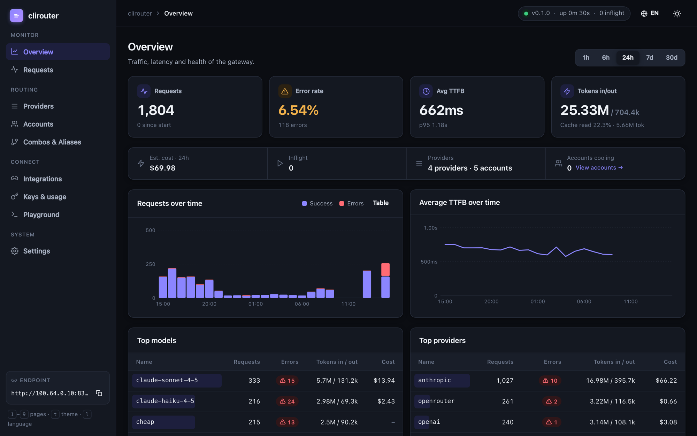 | |
| Dark theme, English / Vietnamese. Keys: `1`–`9` pages, `t` theme, `l` language. | |

## Built for stability and speed

- **Data plane separate from the dashboard.** Inference requests go through no framework or
  middleware chain.
- **No synchronous I/O on the hot path.** Routing state lives in memory with per-account locks.
  Request logs go through a bounded channel to a batching SQLite writer. If the channel is full,
  records are dropped and counted; a request is never blocked.
- **Zero-copy passthrough**: same-format streams are forwarded without parsing every chunk, and
  only the usage-bearing events are inspected. Cross-format streams are encoded directly into the
  client format, with zero allocations per text chunk.
- **Separate timeouts** for connect, first byte, idle and total. A client disconnect cancels the
  upstream request immediately.
- **Keepalive.** After `early_ping`, clirouter commits a 200 and sends format-correct pings
  (`event: ping` for Anthropic, SSE comments for OpenAI) so clients and proxies don't time out.
- **Errors after content has started** are reported in-band in the client's own format.
- **Shared HTTP/2 connection pools** per proxy. Upstream gzip is off, because it batches SSE.
- **OAuth credentials** are encrypted with AES-256-GCM, written atomically, and refreshed in the
  background with single-flight.
- **Tested end to end** against mock upstreams. The suite covers:
  - all 4 client formats × 5 upstream types, streaming and non-streaming, including tools,
    images, thinking and usage, with output checked against each spec;
  - failover on 429, 5xx, 529, connection refused, timeouts and in-band overload errors;
  - client cancellation and graceful shutdown;
  - 200 parallel streams under `-race` with no goroutine or file-descriptor leaks.

  Unit and regression tests run in CI with `go test -race`; benchmarks run with `make bench`.

## Security

clirouter holds every provider key and OAuth token, so it is locked down by default.

- **Binds `127.0.0.1:8317`.** With no `api_keys`, the inference API only accepts direct local
  requests. With no `admin_password`, the dashboard is localhost-only too. The `Host` header must
  be `localhost` / `127.0.0.1` / `[::1]`, which blocks DNS rebinding, and requests carrying
  reverse-proxy headers are rejected.
- **Exposing it** (`listen: 0.0.0.0:8317` or `--listen`): if no `admin_password` is set, the
  first start generates a random one and writes it to `config.yaml`. It is never logged. You can
  also set your own with `admin_password: env:CLIROUTER_ADMIN_PASSWORD`. Add `api_keys` so other
  machines can call the inference API.
- **Admin API**: bearer password compared in constant time, with a 5-minute IP lockout after 10
  failures. Cross-origin browser requests are refused (`Origin` / `Sec-Fetch-Site`) and CORS is
  off. The dashboard sends a strict CSP, `X-Frame-Options: DENY` and `nosniff`.
- **Client keys**: compared in constant time, with a 1-minute IP lockout after 30 failures. Behind
  a reverse proxy on the same host, failures are counted per `X-Forwarded-For` / `X-Real-IP`, so
  one bad client can't lock everyone out. Keys
  created in the dashboard are stored as `sha256:<hex>` and shown only once, so copy them right
  away. To hash one yourself:
  `key: sha256:$(printf %s "$KEY" | shasum -a 256 | cut -d' ' -f1)`.
- **File permissions**: `~/.clirouter` 0700, `config.yaml` 0600, `data/` 0700,
  `clirouter.db` 0600. OAuth tokens in `data/auth/` are AES-256-GCM encrypted. Looser
  permissions are tightened at startup. Provider keys in `config.yaml` are plaintext; use
  `env:NAME` to keep them off disk.
- **No secrets in logs.** Only client key *names* are logged, and upstream error messages
  (including stored ones) are redacted. The admin API returns only the last 4 characters of a key.
- **Upstream redirects are not followed**, so `Authorization` never leaks to another host.
- **Input limits**: body ≤ `routing.max_body_mb` (also after gzip/zstd decoding). Headers are
  capped at 1 MB and 10 s. A body must arrive within 2 min, and each write to a slow client is
  capped at 2 min.

**Exposing it to a network or the Internet**: keep clirouter on `127.0.0.1` and put it behind a
TLS reverse proxy, always with `admin_password` and `api_keys`. Example with Caddy:

```
llm.example.com {
    reverse_proxy 127.0.0.1:8317 {
        flush_interval -1   # don't buffer SSE
    }
}
```

For a small team on a private network, an SSH tunnel or a mesh VPN (e.g. Tailscale) to a
localhost-bound clirouter is the simplest safe setup.

Report vulnerabilities privately; see [SECURITY.md](SECURITY.md).

## Non-goals

These are deliberately left out:

- MITM, `/etc/hosts` hijacking or installing root CAs.
- Spoofing first-party clients' headers, TLS fingerprints or system prompts.
- Web-scraping "providers".
- Sending your prompts to a third-party LLM to decide routing.
- Inflating token usage.

## Known limitations

- **Subscription (OAuth) providers.** The Codex, Claude, Copilot and Gemini CLI login flows are
  implemented but **not yet verified against the live services**. clirouter doesn't impersonate
  first-party clients, so a provider may reject requests: Anthropic may accept subscription
  tokens only from Claude Code, Codex may require its official `instructions`, and Copilot may
  reject a non-VS Code `Editor-Version`. Using a subscription through a proxy may also violate
  the provider's terms; your call.
- Not supported yet: Cursor/Kiro as upstreams, Codex WebSocket transport, and Vertex service
  accounts.
- **Dashboard saves rewrite `config.yaml`.** Comments and formatting are lost, and the whole
  file is replaced, so if two browser tabs edit at the same time, the last save wins. Keep a copy
  if you hand-annotate the file.
- `logging.level` and `logging.capture_bodies` are not applied yet, and changes to
  `retention_days` take effect after a restart.
- Failed requests are logged without the provider/account they last tried.
- Gemini `:countTokens` is not implemented, and Gemini clients need an alias rather than the
  `provider/model` form.
- All format and failover testing used mock upstreams. Real providers' SSE quirks are covered
  only by the translators' unit tests.

## Development

```bash
make test               # go vet + go test -race ./...
make bench              # translator, SSE and proxy-overhead benchmarks
cd web && npm run dev   # dashboard dev server, proxies API calls to :8317
```

Project layout:

| Path | Contents |
|---|---|
| `cmd/clirouter` | Entry point, flags, first-run config |
| `internal/proxy` | Data plane: attempts, failover, keepalive, stream writer |
| `internal/router` | Model resolution, account selection, cooldowns, affinity |
| `internal/translate/*` | Codecs for anthropic, openai (chat), responses and gemini |
| `internal/ir` | Typed intermediate representation |
| `internal/sse` | Fast SSE reader |
| `internal/upstream` | HTTP client pools, error classification |
| `internal/auth` | OAuth flows and the encrypted token store |
| `internal/store` | SQLite request log and stats |
| `internal/server` | Routes, admin API, security middleware |
| `internal/config` | Config schema, defaults, validation, hot reload |
| `web/` | React + TypeScript dashboard (Vite), embedded into the binary |

## License

[GPL-3.0](LICENSE) © clirouter contributors.
